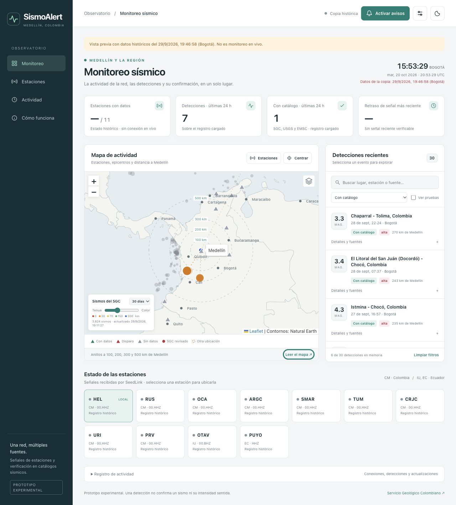
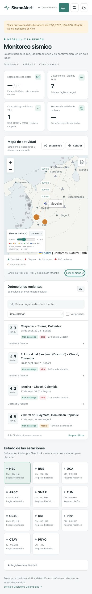

# SismoAlert: experiencia visual y correcciones de interfaz

Preparado el 20 de octubre de 2026 sobre `origin/azure-telegram` (`955ede5`).

El tablero muestra mapa y detecciones en paralelo, un resumen del estado de la red y tarjetas de estaciones. Adapta la distribución a computador, tablet y celular. Incluye tema claro/oscuro, búsqueda sin distinguir tildes, filtros por confirmación, selección de estaciones, ayuda y ajustes de sonido.

## Cambios de funcionamiento

- La pérdida de conexión o ausencia de actualizaciones pone las estaciones en estado sin verificar; el contador de estaciones deja de aparentar un estado actual.
- Las respuestas de `/state` no sobrescriben eventos más recientes recibidos por SSE. Al reconectar se recuerdan también las confirmaciones de catálogo para no repetir sus avisos.
- Los errores de carga se muestran y reintentan; no dejan una pantalla vacía. La lista y las estaciones siguen funcionando si Leaflet no está disponible.
- La prueba de Istmina usa datos históricos incluidos y es local. No invoca `/test`, no consulta catálogos ni envía avisos externos. No cuenta en los indicadores. El endpoint técnico `/test` conserva su comportamiento previo.
- La búsqueda, los filtros, la lista y los marcadores del mapa se mantienen sincronizados. Las detecciones descartadas no generan avisos de navegador.
- El registro conserva un máximo de 200 líneas. Los datos nuevos no interrumpen la selección ni desplazan la página automáticamente.
- Los tiempos de llegada se presentan como estimaciones. Los niveles del detector no se describen como intensidad sentida.
- Los contadores de 24 horas se refieren al conjunto cargado, que puede ser parcial: el servidor conserva hasta 30 detecciones al conectar.
- La copia estática usa los mismos controles e incluye Leaflet y los contornos; identifica la fecha del registro y no se presenta como monitoreo en vivo.

## Verificación

- 40 pruebas existentes de Python: correctas. No se cambiaron el detector, sus umbrales, el servidor ni el envío de Telegram.
- Nueva prueba Python de generación y escape de datos en la copia estática: correcta.
- `node tests/test_ui.js`: sintaxis y seis comprobaciones de estados correctas.
- `node tests/test_dashboard.js`: filtros, estados vencidos, enlaces seguros, actualización concurrente SSE/HTTP, deduplicación al reconectar, errores y simulación local correctos.
- Navegador: búsqueda «choco», filtros, selección de Istmina, detalles, prueba local, ocultar/mostrar estaciones, modal de ayuda y cierre con Escape.
- Pantallas de 320, 390, 820 y 1280 px. Sin desbordamiento horizontal en las medidas comprobadas. Temas claro y oscuro revisados.
- Fallos deliberados: sin Leaflet se muestran las 30 detecciones y las 11 estaciones; sin servidor aparece el estado de reconexión.
- No se solicitaron permisos de notificaciones nativas ni se enviaron mensajes externos durante las pruebas.

## Vista previa y despliegue

La vista previa usa el estado histórico del repositorio correspondiente al **29 de septiembre de 2026, 19:46:58, hora de Bogotá**. No es una consulta al servidor de producción.

El cambio de producción está en `static/index.html`. `copia_estatica.py` actualiza la exportación estática; `README.md` y las pruebas documentan el nuevo comportamiento. No hay dependencias adicionales ni migraciones.

El servicio documentado en `linux/actualizar.sh` consulta `origin/azure-telegram` cada cinco minutos. Integrar la rama de esta revisión en `azure-telegram` activa ese procedimiento si continúa configurado en Azure. El estado actual de ese automatismo no se pudo verificar: la URL exige autenticación y SSH no respondió. La integración se propone mediante una rama de revisión; no se modificó la rama de producción.

## Capturas de la vista previa

Los ejemplos muestran el filtro «Con catálogo» y datos históricos identificados en pantalla.

